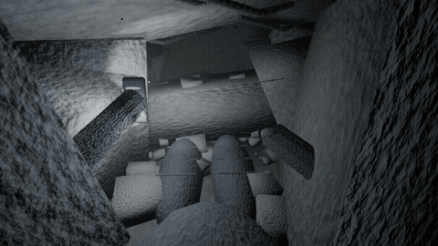

# 잔해 속의 숨 — 실제 3D 애니메이션 v3

[영상 다운로드](./breath_in_the_rubble_intro_v3.mp4?raw=true) · [Blender 원본 ZIP](./intro_v3_source.zip?raw=true)



이 버전은 이미지를 확대하거나 이동하는 영상이 아닙니다. Blender의 실제 3D 공간에서 카메라, 팔, 손, 스마트폰, 손전등, 천장, 낙하 파편과 먼지 입자를 애니메이션하고 프레임별 렌더링한 프로토타입입니다. Unity나 VR 기기에서 캡처한 영상은 아니며, 플레이 가능한 빌드도 아닙니다.

## 실제 움직임
- 하체와 허리를 콘크리트 아래에 고정하고 상체와 시점만 작게 움직입니다.
- 왼손이 스마트폰을 허리 쪽에서 들어 올립니다. 손전등은 휴대폰의 자식이므로 손 움직임에 따라 조사 방향과 그림자가 바뀝니다.
- 고개를 내려 묻힌 다리를 확인하고 좌우를 살핍니다.
- 여진에 천장이 더 내려앉고 작은 3D 파편이 떨어집니다.
- 오른팔을 들어 머리 쪽을 가렸다가 내립니다.
- 철근의 돌기, 콘크리트 표면, 의복은 간단한 메시와 절차적 재질로 구성합니다.
- 스마트폰의 LED와 화면/산란광을 나타내는 약한 휴대폰 부착 광원을 사용합니다.

## 원본과 재생성
`intro_v3.blend`에 모델, 재질, 카메라, 조명과 18초 애니메이션이 들어 있습니다. 640×360, 24fps, 432프레임입니다. MP4에는 마지막 2초 제목과 합성 효과음을 더했습니다.

Blender 4.3.2에서 파일을 열어 타임라인을 재생하거나 아래 명령으로 렌더링합니다. Blender가 설치된 PC에서 실제 파일 위치에 맞게 경로를 변경하세요.

```bash
blender -b intro_v3.blend -o ./frames/ -s 1 -e 432 -a
```

`build.py`, `refine.py`, `finalize_scene.py`, `apply_bounce.py`는 순서대로 실행한 제작 스크립트이며 출력 경로가 원래 클라우드 작업 폴더로 지정되어 있습니다. 원본 `.blend`로 작업할 때는 이 스크립트들을 재실행할 필요가 없습니다.

## Unity로 옮길 때
Blender에서 모델을 FBX로 내보내고, 재질은 Unity에서 다시 연결합니다. 애니메이션용 카메라 움직임은 영상용이므로 XR Origin에 그대로 적용하지 마세요. HMD 추적을 유지하고, 여진은 천장·파편·사운드·햅틱으로 전달합니다. 손 애니메이션은 실제 컨트롤러 추적과 XR Grab으로 바꿉니다. 폰의 조명은 Transform 자식으로, 먼지는 Particle System으로 구현할 수 있습니다.

단순한 저예산 그래픽의 연출 검증용입니다. 상체/팔/손은 간소화된 모델이며 충돌 회피나 인체 리깅의 완성도는 제한적입니다. PC VR/Quest 성능 검증은 하지 않았습니다.
